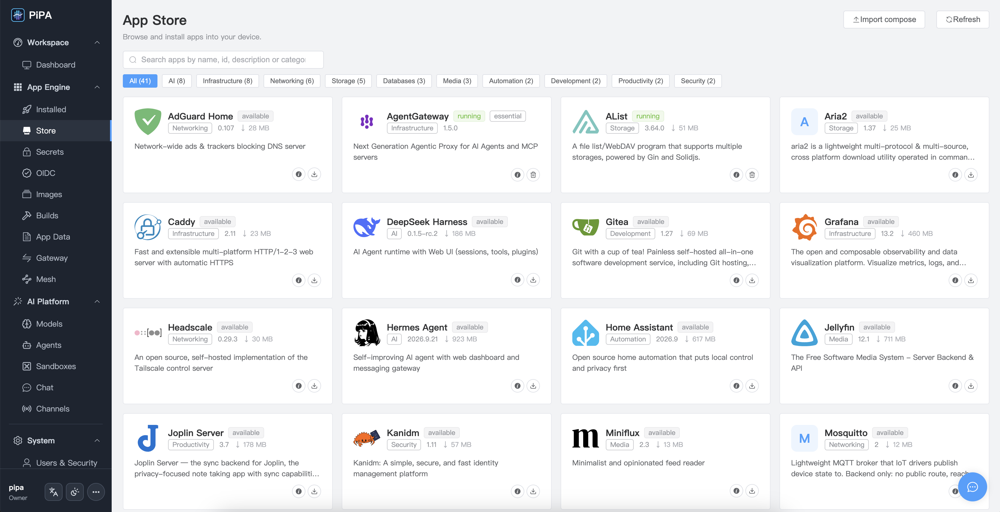

# PiPA Server

Self-hosted control plane for running apps and containers at home.

PiPA Server is the console/service that lets you deploy and manage
self-hosted apps and containers from a single web UI. It is distributed as a
container image on GitHub Container Registry (GHCR).



*The console: installed apps, their state, and the shared app network in one view.*

## Quick start

```sh
# pull the image
docker pull ghcr.io/pipa-os/pipa-server:0.1.9

# start it (compose.yaml is in this repo)
docker compose up -d

# open the console
#   http://localhost:8080
```

(podman works identically: `podman pull` / `podman compose up -d`.)

`compose.yaml` in this repository is all you need. The server binary is shipped
inside the container image pulled from GHCR — there is nothing to compile.

## Container runtime (required)

PiPA Server talks to the **host** container runtime over its Docker-compatible
Unix socket and manages containers on that host directly. The socket **must be
bind-mounted into the container** at `/var/run/docker.sock`, otherwise the
server fails with a "container runtime unavailable" error.

The **source** path depends on how the host runs the runtime. Set it with
`PIPA_RUNTIME_SOCKET` (in a local `.env` next to `compose.yaml`, or in the
shell); the default is `/var/run/docker.sock`:

| Host runtime    | `PIPA_RUNTIME_SOCKET`                                             |
|-----------------|-------------------------------------------------------------------|
| rootful docker  | `/var/run/docker.sock` (default)                                  |
| rootless docker | `$XDG_RUNTIME_DIR/docker.sock`, e.g. `/run/user/1000/docker.sock` |
| rootful podman  | `/run/podman/podman.sock`                                         |
| rootless podman | `$XDG_RUNTIME_DIR/podman/podman.sock`                             |

Example `.env` for a rootless docker host:

```
PIPA_RUNTIME_SOCKET=/run/user/1000/docker.sock
PIPA_DATA_DIR=/home/<user>/.local/share/pipa-data
```

A rootless runtime also cannot create app data volumes under `/var/pipa-data`
(root-owned), so set `PIPA_DATA_DIR` to a path the runtime user can write.

Then confirm the container can reach it:

```sh
docker exec pipa-server ls -l /var/run/docker.sock    # expects srw-rw----
```

`PIPA_RUNTIME_SOCKET` is read by `docker compose` (the host-side source path);
the in-container probe path stays `/var/run/docker.sock`.

(Do not use the `containerd` backend — it is intentionally unsupported:
containerd does not provide name resolution, log storage, or restart policies,
so driving it would mean reimplementing those. The probe reports it as
unsupported.)

## Configuration

| Env / volume        | Purpose                                            |
|---------------------|----------------------------------------------------|
| `8080`              | Web console / OpenAPI listener                      |
| `/var/run/docker.sock` | Runtime socket inside the container (mount target) |
| `/run/pipa`         | Host pipa-agent socket (mount `:ro` when present)   |
| `pipa-appstore`     | Persistent imported-apps / appstore data volume    |
| `pipa-auth`         | Persistent local accounts, hashes and sessions      |
| `pipa-webdav`       | Persistent WebDAV uploads                           |
| `PIPA_RUNTIME_SOCKET` | Compose-time host path of the runtime socket (default `/var/run/docker.sock`) |
| `PIPA_DATA_DIR` | Host path where app data volumes are created (writable by the runtime user) |
| `PIPA_CONTAINER_NAME` | Own container name (lets the server join `pipa-ingress`; required on compose) |
| `PIPA_IMAGE_REGISTRY` | Registry serving pipa's own images; default `ghcr.io/pipa-os` (pipa-proxy / mesh / toonflow) |
| `PIPA_RUNTIME`      | `auto` (default) \| `podman` \| `docker`            |
| `PIPA_DOCKER_SOCKET` | Override the docker socket path inside the container |
| `PIPA_PODMAN_SOCKET` | Override the podman socket path inside the container |
| `PIPA_AGENT_SOCKET` | Override the agent socket path (default `/run/pipa/pipa-agent.sock`) |
| `PIPA_SERVER_IMAGE` | Override the image (e.g. to use your own mirror)    |

The agent socket is only needed when `pipa-agent` runs on the host (for example
on PiPA OS). Without it the console still serves, but operations that touch the
host (creating containers/volumes/networks) are unavailable.

## Image & downloads

- Container image: `ghcr.io/pipa-os/pipa-server:0.1.9`
  (packages page: https://github.com/orgs/pipa-os/packages — public)
- This repository contains only the deployment configuration and documentation.
  The server binary is **not open source**.

## License

The files in this repository (compose.yaml, documentation) are released under
the Apache License 2.0 — see [LICENSE](LICENSE). The `pipa-server` binary image
it references is proprietary software distributed via GHCR; its source is not
published here.
